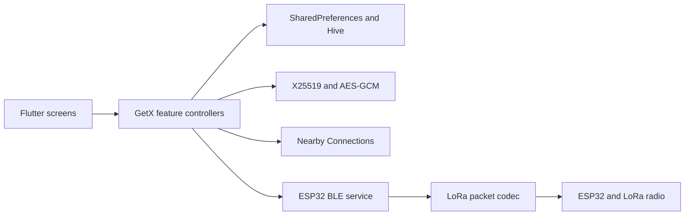
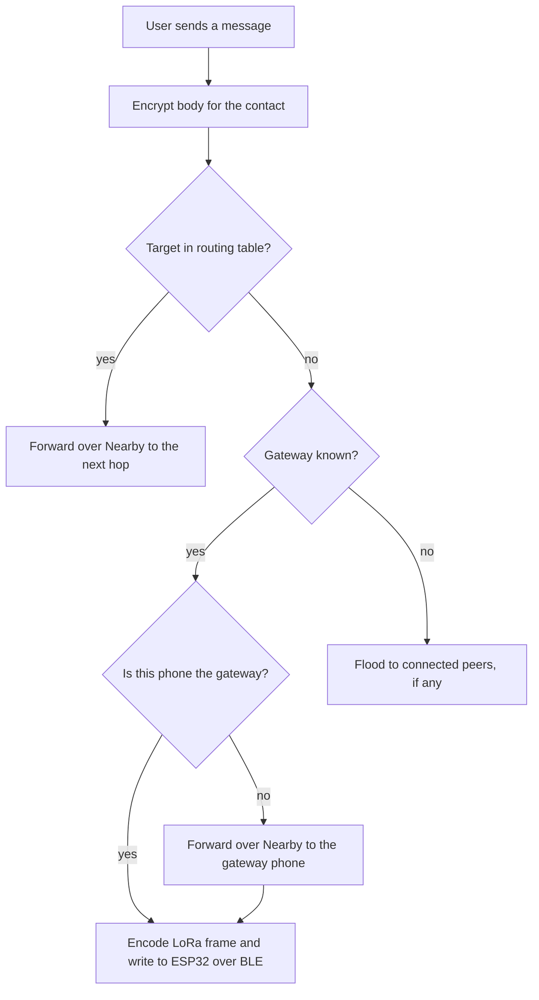
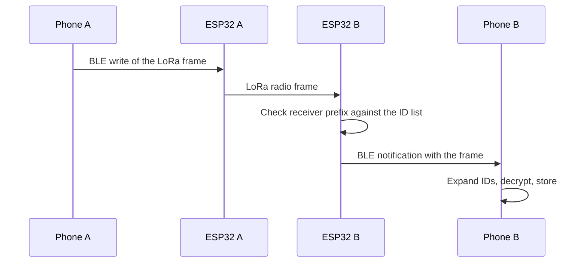

# HopTalk

HopTalk is an Android-first, offline messaging app. Nearby phones find each other with Google Nearby Connections and relay encrypted messages for one another. An optional ESP32 LoRa gateway can carry encrypted packets beyond the reach of the phone-to-phone network. There is no cloud messaging backend and no account system.

## Contents

- [For app users](#for-app-users)
- [How HopTalk works](#how-hoptalk-works)
- [ESP32 and LoRa integration](#esp32-and-lora-integration)
- [Limits and known limitations](#limits-and-known-limitations)
- [Development commands](#development-commands)
- [Contributing](#contributing)
- [License](#license)

## For app users

### Run the app from source

You need Flutter with the Dart SDK version allowed by `pubspec.yaml` (`^3.13.1`), Android SDK platform 37, and an Android phone. The nearby peer-to-peer feature uses the Android-only `nearby_connections` plugin, so use Android for the full mesh experience. A physical phone is recommended because Bluetooth and LoRa gateway features are not available in a regular emulator.

1. Install Flutter and Android Studio or the Android command-line tools. Check the setup with `flutter doctor`.
2. Clone the app repository and connect an Android phone with USB debugging enabled:

   ```sh
   git clone https://github.com/nuhanchowdhurylinkdin-a11y/HopTalk.git
   cd HopTalk
   ```

3. From the repository root, run:

   ```sh
   flutter pub get
   flutter run
   ```

4. On first launch, finish onboarding, choose a display name and profile image, then grant the requested Bluetooth, location, and nearby-device permissions. Keep Bluetooth and the device's location service enabled while using nearby discovery.

### Start a conversation

1. Launch HopTalk on both Android phones and complete setup on each one.
2. From Home, open the QR contact screen. Each person scans the other person's HopTalk QR and confirms the contact. Both sides should add each other. This exchange shares the public encryption key used for messages.
3. Keep both apps open with nearby permissions enabled. HopTalk advertises and discovers peers and attempts to connect automatically; the nearby screen also provides connection controls (connect, block, unblock) and a "Restart Scanning" button.
4. Open the contact's chat and send a message. Message history is stored on the device.

### Use the optional LoRa gateway

LoRa requires a compatible ESP32 board and SX1278/RA-02 radio, with the HopTalk ESP32 gateway firmware flashed onto the board. In the app's **LoRa** tab, scan for and connect to the gateway. One phone connected to a board acts as that mesh group's gateway; other phones can send their encrypted packets to it over the phone mesh. Keep that gateway phone and ESP32 powered and connected while the group needs LoRa.

When you message a contact who is not reachable through the phone mesh, and a gateway is known, HopTalk sends the message over LoRa automatically. For the other side to read it, that person needs your public key, so both people must have scanned each other's QR. All boards that should talk to each other must use identical radio settings.

The firmware project is maintained separately in the [HopTalk ESP32 repository](https://github.com/nuhanchowdhurylinkdin-a11y/HopTalk-esp32). Its README contains wiring, radio setup, build instructions, and the BLE protocol. The firmware and app must agree on packet format and BLE UUIDs.

### What to expect

- Nearby messaging uses local phone-to-phone connections and does not need internet access.
- Contact QR exchange is needed so the app knows and can verify a peer's public encryption key before sending messages.
- Chat history and profile/setup data are stored locally. Chat records use an encrypted Hive store with its key held in platform secure storage.
- LoRa has a much smaller payload than nearby messaging. The current packet format allows up to 147 UTF-8 bytes of message text before encryption and packet headers; longer messages may not fit over LoRa. Characters outside basic Latin take more than one byte (a Bengali character takes three), so fewer characters fit.
- LoRa gives no delivery guarantee. A message can be lost, and the app does not retry it.
- BLE and location permissions are required for discovery. Android may also ask for Nearby Wi-Fi permission, depending on the Android version.

## How HopTalk works

### Architecture

HopTalk is a Flutter app using GetX for routes, dependency lookup, and reactive controller state. `main.dart` initializes local storage and the chat service, then chooses onboarding, profile setup, permissions, or Home based on saved setup state.



#### Main folders

| Path | Responsibility |
| --- | --- |
| `lib/main.dart`, `lib/routes/` | Startup, storage initialization, initial route, and GetX routes. |
| `lib/core/` | Shared preferences, app bindings, UI helpers, colors, and responsive layout utilities. |
| `lib/features/onboarding/` | First-launch introduction and completion state. |
| `lib/features/setup/` | User profile, avatar/image selection, and generated local user ID. |
| `lib/features/home/` | Chat and LoRa tabs, conversation list, profile entry, and mesh status. |
| `lib/features/chat/` | Chat UI/controller, paged message history, seen receipts, and encrypted local chat storage. |
| `lib/features/qr/` | Creating/scanning contact QR codes and confirming a peer's public key fingerprint. |
| `lib/features/mesh_network/controller/` | `MeshNetworkController` plus part files: `permissions_extension.dart`, `connections_extension.dart`, `messaging_extension.dart`, `routing_extension.dart`, `contacts_extension.dart`, `esp32_extension.dart`. |
| `lib/features/mesh_network/service/` | `crypto_service.dart` (X25519/AES-GCM), `esp32_ble_service.dart` (BLE transport to the ESP32), `lora_codec.dart` (binary LoRa frames). |
| `lib/features/mesh_network/models/` | `RouteEntry`, `QrContactData`, and `LoRaPacket` data types. |
| `lib/features/permission/` | Permission-related feature files; check `lib/routes/app_routes.dart` for the active permission screen route. |
| `assets/` | Onboarding art, avatars, app images, and font. |
| `android/`, `ios/`, `macos/`, `linux/`, `windows/` | Flutter platform runner projects. Nearby Connections mesh currently targets Android. |

### Identity and contacts

- On first setup the app generates a local **user ID** and stores it with the profile in the Hive `userProfileBox`. IDs are hexadecimal strings (the LoRa codec requires at least 16 hex characters; current IDs are 64-character hex strings).
- When the mesh starts, `CryptoService` creates a long-lived **X25519 key pair** (or loads the saved one). Both key halves are kept in `flutter_secure_storage` under `x25519_private` and `x25519_public`.
- A profile is: display name (up to 30 characters), an avatar asset path (`assets/setup_avatars/*.svg`), and an optional JPEG thumbnail. For the mesh, the thumbnail is shrunk to at most 12,000 Base64 characters (it tries 128, 96, then 64 pixels with decreasing quality; if it still does not fit, no image is sent).
- When the user edits their profile, `updateLocalProfile` bumps the profile version, rebuilds the thumbnail, sends a fresh `PROFILE` packet and routing table to connected peers, and restarts advertising and discovery with the new name.
- Because endpoint names and LoRa frames only carry a 16-character (8-byte) ID prefix, several checks compare user IDs by prefix.

#### QR contact exchange

The QR code is a small JSON document:

| Key | Meaning |
| --- | --- |
| `v` | Payload version. Currently `1`; anything else is rejected. |
| `u` | The person's user ID. |
| `n` | Display name (up to 30 characters). |
| `k` | X25519 public key, Base64 (must decode to exactly 32 bytes). |
| `a` | Avatar asset path, or empty. |

The profile image is never put in the QR code. After a scan, the app shows the name and a short key fingerprint (the first 8 Base64 characters of the key, shown as two groups of four) and asks for confirmation. Own QR codes and blocked users are rejected.

Saving a QR contact does three things:

1. The contact is written to the encrypted conversation store with the public key and a `qr` flag, so the key survives restarts. This is the only place where a peer's key is persisted.
2. The key is placed in the in-memory `knownProfiles` map with a `local` flag. Profiles flagged `local` are not gossiped to the mesh.
3. Any messages that arrived earlier from that person and could not be decrypted yet are retried.

If a QR code arrives for someone whose saved key differs from the scanned key, the app returns `KEY_CHANGED` and the UI asks the user to confirm before the key is replaced. On startup, saved QR contacts are loaded back into `knownProfiles`.

Keys learned from the mesh (`PROFILE` packets) are trusted for the current session only and are not persisted.

### Discovery and connections

- Strategy: `P2P_CLUSTER`. Service ID: `com.hoptalk.mesh`.
- Every phone advertises and discovers at the same time. The advertised endpoint name is `<first 16 characters of user ID>|<display name>`, with the name cut to 40 UTF-8 bytes.
- To avoid both sides connecting at once, the phone whose 16-character ID prefix sorts lower connects immediately. The other phone waits 6 seconds and connects only if there is still no connection. If an ID is not known yet, the phone connects immediately.
- A failed request is retried up to 3 times, after 3, 6, and 9 seconds.
- Incoming connections from blocked users are rejected. All others are accepted automatically, and only `BYTES` payloads are used.
- After a connection is established, each side sends a `HANDSHAKE`. The handshake registers the neighbor, creates a 1-hop route, sends the routing table, and sends known profiles.
- The block list is kept in memory by `MeshNetworkController`.

### Packets over Nearby Connections

Every packet is a UTF-8 JSON object sent as a Nearby `BYTES` payload (at most 32 KB).

| `type` | Purpose | Main fields |
| --- | --- | --- |
| `HANDSHAKE` | Introduce yourself after connecting | `userId`, `userName` |
| `ROUTING_UPDATE` | Share reachable users | `senderUserId`, `routes[]` with `destinationId`, `hopCount`, `gw` |
| `PROFILE` | Share a profile and its public key | `userId`, `userName`, `avatar`, `image`, `publicKey`, `version` |
| none (chat message) | Encrypted message | `messageId`, `senderId`, `targetId`, `body`, `isLora`, `hopCount`, `ttl`, optional `gw` |
| `SEEN` | Encrypted receipt for received messages | same fields as a chat message |
| `MSG` | Internal label for a message that arrived over LoRa and is injected into the mesh | same fields as a chat message, plus `viaLora` |

A chat message looks like this:

```json
{
  "isLora": false,
  "messageId": "a1b2c3d4e5f60718",
  "senderId": "<64 hex characters>",
  "targetId": "<64 hex characters>",
  "body": "<Base64 of nonce + ciphertext + tag>",
  "hopCount": 0,
  "ttl": 16
}
```

A message that must travel over LoRa also carries `"isLora": true` and `"gw": "<user ID of the gateway phone>"`. The `messageId` is 8 random bytes written as 16 hex characters.

`PROFILE` packets are validated before use: the key must be valid Base64 for 32 bytes, the avatar must be one of the bundled asset paths, and the image must be a JPEG of at most 12,000 Base64 characters. A profile is accepted when it is new, has a higher version, or has the same version and finally includes an image. A profile whose key differs from the key already known for that user is ignored. Accepted profiles are saved as contacts (without the key) and forwarded to the other connected peers.

### Routing

HopTalk uses a small distance-vector table plus flooding as a fallback.

`routingTable` maps a destination user ID to a `RouteEntry`:

| Field | Meaning |
| --- | --- |
| `destinationId` | The user this route leads to. |
| `nextHopId` | The Nearby endpoint to send to, or `SELF` for this phone's own entry. |
| `hopCount` | Number of hops (`0` for self, `1` for a direct neighbor). |
| `avatar`, `imageByte` | Profile data attached to the route for the UI. |
| `hasEsp32` | `true` when that user's phone has an ESP32 gateway connected. |

How the table is maintained:

- A phone's own entry has hop count 0 and `hasEsp32` set to whether its ESP32 is connected. Connecting or disconnecting an ESP32 re-broadcasts the table.
- A direct neighbor is added with hop count 1 after its handshake.
- A `ROUTING_UPDATE` lists every entry except those whose next hop is the receiving neighbor (split horizon). The receiver adds 1 to each hop count, ignores its own ID, and ignores routes longer than 16 hops.
- A route is replaced when it is new, when the same neighbor reports a changed hop count or gateway flag, or when it is strictly shorter than the current one through a different neighbor.
- Routes that went through a neighbor but are no longer advertised by it are removed. When a neighbor disconnects, every route through it is removed.
- Changes are re-broadcast to the other neighbors, and the whole table is re-broadcast every 30 seconds.
- `bestGateway()` returns the entry with `hasEsp32` and the lowest hop count (this phone counts, at hop 0).

Forwarding (`_forwardPacket`) picks a route key: the gateway ID for LoRa-bound packets, otherwise the target ID. If a route exists and its next hop is connected and is not the neighbor the packet came from, the packet goes only to that next hop. Otherwise it is flooded to every connected neighbor except the one it came from. Relayed packets have `ttl` reduced by 1 and `hopCount` increased by 1, and are dropped when `ttl` reaches 1. The default TTL is 16. Duplicates are suppressed with a cache of the last 200 message IDs.

### Sending a message



1. `broadcastMessage` needs the contact's public key. Without it the send fails.
2. In debug builds, the chat screen has a "Force LoRa" toggle that sends over LoRa even when a mesh route exists.
3. The text is encrypted (see below) and wrapped in the JSON packet. The outgoing message is stored locally only after the packet was handed to a transport.
4. When the gateway is another phone, that phone receives the packet, sees `isLora` and `gw` equal to its own ID, and passes it to its ESP32. If its ESP32 is not connected, the packet is dropped.

### Receiving a message

1. A packet arrives over Nearby (or is rebuilt from a LoRa frame). Packets from blocked users are dropped, and a message ID already seen is dropped.
2. If the target is not this phone, the packet is passed to the ESP32 (when this phone is the chosen gateway) or relayed to the mesh.
3. If the target is this phone, the sender's public key is looked up. If it is not known yet, up to 20 packets per sender are kept in memory and retried when that sender's profile or QR contact arrives.
4. The body is decrypted. A failure is logged and the packet is dropped.
5. The message is saved to the conversation store with the receive time, then published on a stream so an open chat updates immediately.

### Delivery receipts

A `SEEN` packet is a normal packet whose encrypted body is a JSON list of message IDs.

- The chat controller sends receipts when a chat is open and unread incoming messages exist (on loading the chat and when a live message arrives). Messages are acknowledged in batches of up to 100 IDs over Nearby.
- When the recipient is not reachable through the mesh but a gateway is, the receipt is sent over LoRa as frame type `0x02`. Over LoRa only the newest 5 IDs are included, to save airtime. Older IDs from the same batch are still marked as acknowledged locally and will not be sent again.
- On the sender's side, matching outgoing messages are marked as seen and the chat shows a double check mark. One check mark means sent.

### Encryption and trust model

- **Key agreement:** static X25519 key pairs. The shared secret is derived from the local private key and the peer's public key.
- **Key derivation:** HKDF with SHA-256, 32 byte output, salt `hoptalk-hkdf-salt-v1`, info `hoptalk-message-v1`. Session keys are cached in memory per peer key.
- **Encryption:** AES-256-GCM with a random 12-byte nonce. The stored and transmitted value is `nonce (12) + ciphertext + tag (16)`, Base64 encoded in JSON packets and raw bytes in LoRa frames. No associated data is used.
- **Overhead:** 28 bytes (nonce plus tag) on top of the plaintext.
- **Trust:** contacts are authenticated out of band by scanning their QR code. A QR key is pinned; a different key for the same user needs explicit confirmation. Keys learned over the mesh are accepted on first use for the running session only, and a different key for a known user is ignored.
- **What stays visible:** routing information, user IDs (or their prefixes), message IDs, packet sizes, and timing are not encrypted. Over LoRa, anyone in radio range can see the frame header (type, message ID, sender prefix, receiver prefix).

### Local storage

| What | Where | Notes |
| --- | --- | --- |
| Profile and setup state | Hive `userProfileBox` (key `current`) and SharedPreferences | Name, avatar, thumbnail, user ID, onboarding state. |
| X25519 key pair | `flutter_secure_storage` (`x25519_private`, `x25519_public`) | Generated on first mesh start. |
| Chat encryption key | `flutter_secure_storage` (`hive_chat_key`) | 32 random bytes, Base64 URL encoded. Used as the Hive AES cipher key. |
| Conversation list | Hive box `conversationsBox` (encrypted) | One record per peer: name, avatar, image, last message preview (up to 80 characters), last time, unread count, last-message seen flag, and for QR contacts the pinned `publicKey` and `qr` flag. |
| Messages | One encrypted Hive `LazyBox<ChatMessage>` per peer (`chat_<peer ID>`) | Messages are stored as plaintext inside the encrypted box. |
| Routing table, mesh-learned profiles, pending undecryptable packets, duplicate cache, block list | Memory only | Rebuilt or lost after a restart. |

`ChatMessage` (Hive type 1) holds `messageId`, `senderId`, `targetId`, `body`, `timestamp`, `hopCount`, and `seen`. History is loaded in pages of 30 (newest first) and trimmed to the newest 2,000 messages per conversation. If a Hive box cannot be opened, for example because its key was lost, `ChatStorageService` deletes and recreates it, so that history is lost.

## ESP32 and LoRa integration

The companion [ESP32 firmware](https://github.com/nuhanchowdhurylinkdin-a11y/HopTalk-esp32) is not included in this app repository. Keep the app and firmware protocol in sync when changing BLE UUIDs, ID commands, packet fields, or limits.

| Item | Current app/firmware contract |
| --- | --- |
| BLE service UUID | `BE28A6AE-FE7A-4394-8858-F48BD1D62026` |
| Phone-to-board RX characteristic (phone writes) | `4AF882CE-9582-4515-BEAB-1941400E169B` |
| Board-to-phone TX characteristic (board notifies) | `718CEFEA-4CE7-4A32-BC46-8C24BC97BD7E` |
| User ID list | Phone sends a snapshot bracketed by `0xF0` and `0xF1`; route changes use `0xA1` add or `0xA2` remove followed by a 16-character hexadecimal ID prefix. |
| LoRa frame | 25-byte header plus encrypted body; byte 0 is message (`0x01`) or seen receipt (`0x02`), and the 8-byte receiver ID prefix starts at byte 17. |
| Firmware packet size | 25 to 200 bytes. LoRa radio settings and queue limits are defined in the companion firmware's `include/ProjectConfig.h` and `src/LoRaRelay.cpp`. |

The board routes using receiver IDs and does not decrypt message content. Its radio queue and duplicate cache are in RAM, so they are cleared after restart. See the firmware README for wiring, radio limitations, and its complete protocol notes.

### Phone to ESP32 over BLE

`Esp32BleService` uses `flutter_blue_plus` and acts as the BLE central:

1. **Scan** for 8 seconds, filtered on the service UUID.
2. **Connect** with up to 5 attempts (10 second timeout each, 2 seconds apart), after stopping any scan. The MTU is requested after connecting (247), because asking during the connect call made failures harder to tell apart.
3. **Discover services.** If the HopTalk service is missing, the Android GATT cache is cleared and discovery runs once more. This helps when the UUIDs of a board were changed and Android remembers the old service list.
4. **Find characteristics** RX (writes) and TX (notifications) and enable notifications on TX.

Every write must fit in `MTU - 3` bytes (244 bytes at MTU 247). Writes use write-with-response so each one is confirmed.

### The user ID list

The board only forwards received radio frames whose receiver prefix is in its ID list, so the phone keeps that list current:

- **Snapshot:** `0xF0`, then one write per ID (16 lowercase hex characters as ASCII), then `0xF1`. The board replaces its list when it sees `0xF1`. A snapshot is sent when the ESP32 connects and when the mesh is (re)started.
- **Delta:** after the snapshot, each routing table change is sent as one write: `0xA1` (add) or `0xA2` (remove) followed by the 16 characters.
- The list contains the 16-character prefixes of every user in the routing table, including this phone's own ID. Deltas are queued and written one at a time, in order. If two different IDs share the same 16-character prefix, syncing is refused and the error is shown in the app.

### LoRa frame

| Bytes | Content |
| --- | --- |
| 0 | Type: `0x01` message, `0x02` seen receipt |
| 1 to 8 | Message ID (8 random bytes) |
| 9 to 16 | Sender ID prefix (first 8 bytes of the user ID) |
| 17 to 24 | Receiver ID prefix (first 8 bytes of the user ID) |
| 25 to end | AES-GCM output: nonce (12) + ciphertext + tag (16) |

The total size is limited to 200 bytes, which leaves 147 bytes for message text. `LoRaCodec` converts between this frame and the mesh JSON packet. Fields that only matter on the phone mesh (`ttl`, `hopCount`, `gw`, `isLora`) are not sent over the air. The frame type comes from the packet `type`: `SEEN` becomes `0x02`, everything else `0x01`.



### Receiving a LoRa frame on the phone

`handleLoraBytes` runs when the board notifies the phone:

1. The frame is decoded. Unknown types and short frames are dropped.
2. The receiver prefix is expanded to a full user ID by matching this phone's own ID and then the routing table. If nobody matches, the frame is dropped.
3. The sender prefix is expanded by matching this phone's own ID and then known profiles (QR contacts or mesh profiles). If nobody matches, the frame is dropped. This applies to the gateway phone too, even when the message is meant for another phone in its mesh.
4. Duplicates are dropped using the message ID with a `lora_` prefix, and blocked senders are dropped.
5. The frame is turned back into a mesh packet (marked `viaLora`). If it is for this phone, it is decrypted and stored, or processed as a receipt. If it is for another phone in the routing table, it is forwarded over Nearby. Otherwise it is dropped.

## Limits and known limitations

| Limit | Value |
| --- | --- |
| Nearby packet size | 32 KB |
| Chat input length | 1,000 characters |
| LoRa frame size | 200 bytes (25 header + 28 encryption overhead + up to 147 text bytes) |
| Display name | 30 characters (40 bytes in the advertised endpoint name) |
| Profile thumbnail | 12,000 Base64 characters |
| Hop limit and message TTL | 16 |
| Duplicate message ID cache | 200 entries |
| Undecryptable packets kept per sender | 20 (memory only) |
| Receipt IDs per packet | 100 over Nearby, 5 over LoRa |
| Routing table broadcast interval | 30 seconds |
| Stored messages per conversation | 2,000 |
| BLE write size | MTU minus 3 bytes |

Known limitations:

- The mesh runs on Android only.
- There is no delivery guarantee and no retransmission. LoRa radios are half-duplex and cannot hear while sending, so frames can be lost. A lost receipt looks the same as a lost message.
- Receipts over LoRa are only sent when the recipient opens the chat, and only for the newest 5 messages per receipt.
- Static key pairs mean there is no forward secrecy. Packet headers are not bound to the ciphertext (no associated data), and replay protection is limited to the duplicate cache.
- Routing updates and mesh profiles are not authenticated. A connected peer can advertise false routes. Only QR-confirmed keys are pinned across restarts.
- Over LoRa, message IDs and sender and receiver ID prefixes are visible to anyone in radio range.
- The block list is not saved across app restarts.
- The size limit for LoRa is enforced when the frame is encoded, which happens on the gateway phone.
- Please check applicable regulations for the radio frequency you use. This project does not provide legal guidance.

## Development commands

```sh
flutter pub get
flutter analyze
flutter test
```

To run on a connected Android phone:

```sh
flutter devices
flutter run -d <android-device-id>
```

In debug builds, log lines are printed with the prefixes `[Mesh]`, `[ESP32 BLE]`, and `[LoRaCodec]`. They are disabled in release builds.

## Contributing

Read [`CONTRIBUTING.md`](CONTRIBUTING.md) before making a change. Protocol changes should be reviewed for both the app and companion firmware, and pull requests should include the checks that were run.

## License

The HopTalk application source in this repository is licensed under the **GNU General Public License v3.0 only** (`GPL-3.0-only`). See [`LICENSE`](LICENSE) for the full text. Third-party packages and assets may have separate licenses; consult their respective notices.